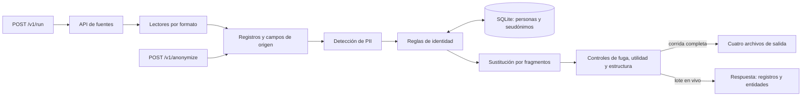

# Kipu Pay: diseño del anonimizador

## Problema

El corpus inicial tiene 2.028 mensajes, 26 documentos y 6.243 filas. Las fuentes crecerán durante el reto. Cada regeneración debe incluir todos los registros, una vez y con su mismo ID. La dificultad principal es reconocer a una persona cuando aparece en varias fuentes sin confundirla con otra que tiene el mismo nombre. También hay datos personales fuera del texto visible: adjuntos, metadata de PDF, comentarios HTML y notas de tablas.

La salida debe servir para entrenar atención al cliente. Conservaremos el orden de la conversación, quién habla con quién, montos, motivos de soporte, fechas de transacción, claves entre tablas y entidades públicas. Solo cambiaremos datos que identifiquen a personas. Si barrio, ocupación y año identifican a alguien al combinarse, generalizaremos lo necesario en todos los registros donde aparezca esa combinación. No borraremos registros ni reescribiremos conversaciones completas.

## Solución

`POST /v1/run` leerá el inventario actual del API de fuentes y producirá los cuatro archivos exigidos: `chats.jsonl`, `docs.jsonl`, `tables.jsonl` y `entities.json`. Los chats, documentos y tablas conservarán sus campos y relaciones. `POST /v1/anonymize` procesará registros nuevos con las mismas reglas y el mismo mapa de personas. El servicio también expondrá `/v1/health`, `/v1/run/{job_id}`, `/v1/output/{archivo}` y `/v1/entities`, según el contrato oficial.

Un lector por formato extraerá el contenido de Slack, PDF, HTML, Markdown, CSV y XML, sin perder metadata, comentarios ni nombres de archivo. Después, reglas propias marcarán nombres, correos normales o escritos con “arroba” y “punto”, teléfonos, cédulas, direcciones, placas, pasaportes, menciones de Slack e identificadores indirectos. Cada hallazgo conservará su campo y registro de origen para sustituirlo en el lugar correcto. No usaremos una librería o servicio de anonimización PII ya hecho.

La identidad se resolverá por evidencias en orden: primero IDs de cliente o empleado; luego contactos y cuentas; después radicados, transacciones, adjuntos y contexto del hilo. **Coincidir en el nombre nunca basta para unir dos personas.** Identificadores incompatibles bloquean la unión. Los casos sin evidencia suficiente se marcan para revisión. SQLite guardará personas, alias, evidencias y seudónimos; `/run` y `/anonymize` consultarán el mismo registro. Las asignaciones sobrevivirán a reinicios y a nuevas versiones de las fuentes.

Para cada persona elegiremos un seudónimo único de un catálogo revisado según el contexto disponible. Una señal explícita de país o región tiene prioridad; si falta, el nombre puede aportar una pista lingüística, pero no demuestra nacionalidad. En casos sin evidencia suficiente usaremos un nombre compatible con el idioma del corpus y registraremos esa incertidumbre. Conservaremos el género cuando haya evidencia suficiente. Una mención con solo el primer nombre se reemplazará por el primer nombre del seudónimo. Correos, cédulas y demás identificadores conservarán categoría y formato, sin quedar demasiado cerca del original. Las sustituciones serán por fragmentos: el resto de la frase quedará igual. Evitaremos hashes, `[REDACTED]`, un nombre falso compartido por varias personas y reescritura completa con LLM porque pierden utilidad o mezclan identidades. Un LLM solo podría ayudar a clasificar casos ambiguos, nunca ser la única barrera contra fugas.

## Cómo lo comprobaremos

Compararemos los IDs de entrada y salida con `record_index`: cero faltantes, duplicados o extras. La muestra oficial y las cinco pruebas públicas permiten medir fugas conocidas, falsos positivos, homónimos y consistencia. Añadiremos casos para PDF, HTML, XML, correo hablado e identificadores indirectos, pues la muestra no cubre todos los formatos. Revisaremos que columnas, metadata y adjuntos permanezcan, que el texto no personal no cambie, y que `entities.json` declare las formas realmente sustituidas. Una reconstrucción con fuentes ampliadas debe mantener los seudónimos anteriores y asignar otros únicos a personas nuevas. Mediremos menos de dos horas por corrida y menos de 60 segundos por lote de 50.

El diccionario `entities.json` contiene las formas originales porque el jurado lo exige; no forma parte del corpus comercial. Para la demo inicial trabajaremos en local. El despliegue público requerido para la evaluación se resolverá después.
